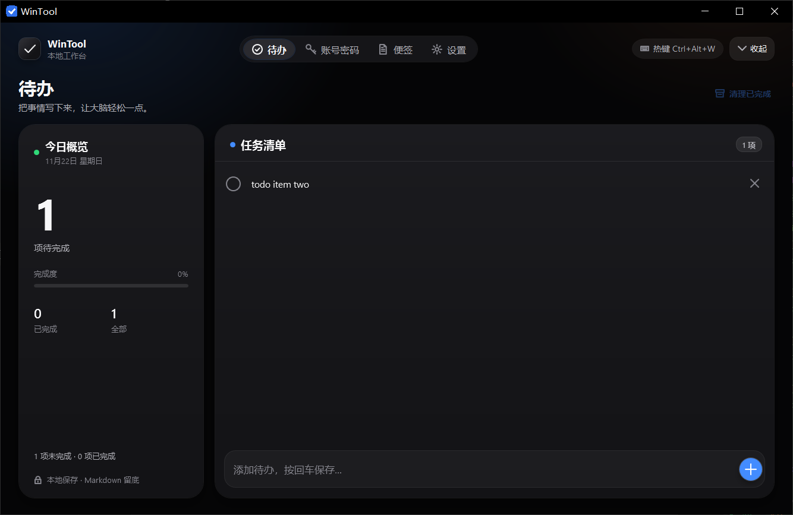
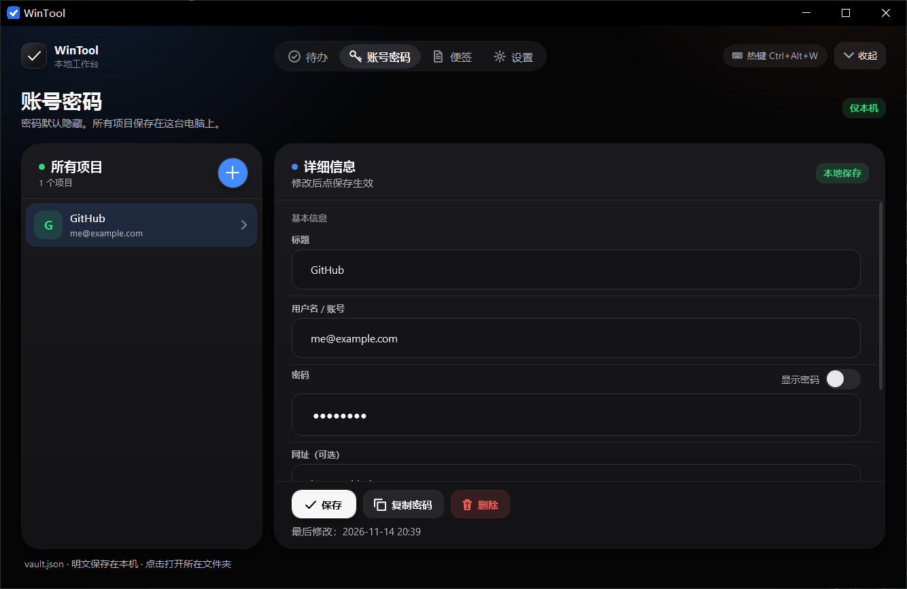
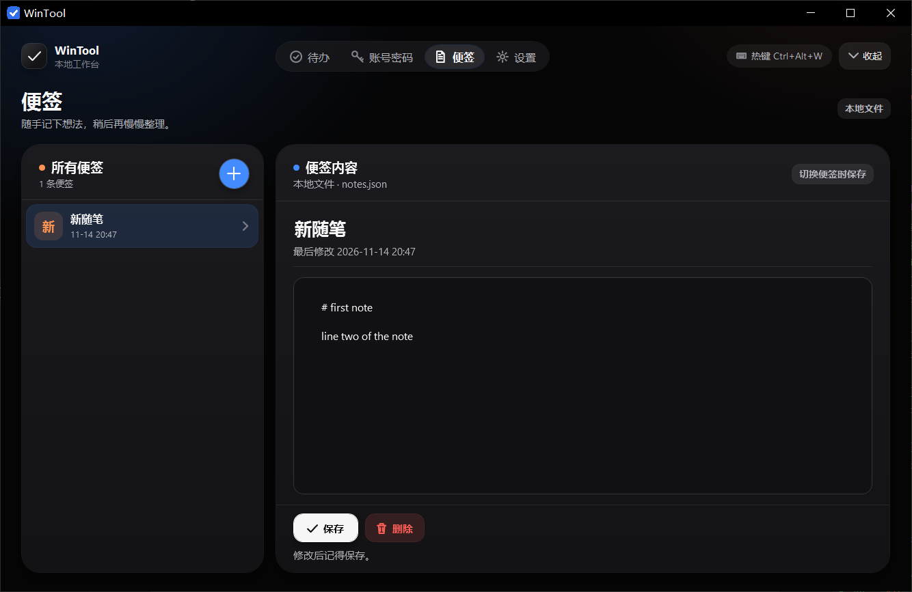

# WinTool

**待办、账号密码和便签，收进一个安静、本地优先的 Windows 工作台。**

[](https://github.com/XSanShi/WinTool/actions/workflows/ci.yml)



[下载最新版](../../releases/latest) · [构建与发布](docs/构建与发布.md) · [产品与实现方案](docs/Win_Tool_产品与实现方案_v0.6.md)

## 功能

- **待办**：快速添加、勾选完成、清理已完成事项；清理前自动写入按月归档的 Markdown 留底。
- **账号密码**：在本地保存站点、用户名和密码，支持显示/隐藏与一键复制。
- **便签**：随手记录想法，标题与正文分开保存，适合临时整理。
- **悬浮球与热键**：关闭窗口只会收起到屏幕边缘；点悬浮球或按 `Ctrl+Alt+W` 唤回。
- **本地优先**：无账号、无云端、无遥测，不需要联网即可使用。
- **单实例**：重复启动只会唤出已经运行的窗口。

<details>
<summary>查看更多界面截图</summary>

| 账号密码 | 便签 |
| --- | --- |
|  |  |

</details>

## 下载

前往 [GitHub Releases](../../releases/latest) 下载最新版本。发布资产包含：

| 文件 | 说明 |
| --- | --- |
| `WinTool.exe` | 推荐。自包含单文件，不需要安装 .NET |
| `WinTool-0.1.0-win-x64.zip` | 便携压缩包，解压后运行 `WinTool.exe` |

**系统要求**：Windows 10 1809+ / Windows 11，x64。

> [!IMPORTANT]
> 当前 EXE 没有数字签名。Windows SmartScreen 可能显示“未知发布者”，这是未签名应用的正常提示。请在 Release 页面核对 SHA256 后再运行。

建议把 EXE 放在有写入权限的独立文件夹中，例如 `D:\Apps\WinTool\`。不要直接放进 `Program Files`，否则程序会回退到 `%LOCALAPPDATA%\WinTool\` 保存数据。

## 首次使用

1. 双击 `WinTool.exe`。首次启动会在 EXE 同级创建 `data\` 和 `待办留底\`。
2. 顶部胶囊导航切换“待办 / 账号密码 / 便签 / 设置”。
3. 右上角 `×` 或 `Alt+F4` 会隐藏到悬浮球，不会退出进程。
4. 真正退出：右键任务栏托盘图标 → 退出。
5. 唤回窗口：点击贴边悬浮球，或按全局热键 `Ctrl+Alt+W`。

## 数据与隐私

数据默认保存在 EXE 同级的以下位置：

| 路径 | 内容 |
| --- | --- |
| `data\todos.json` | 待办事项 |
| `data\vault.json` | 账号密码 |
| `data\notes.json` | 便签 |
| `data\settings.json` | 留底目录等设置 |
| `待办留底\待办留底-YYYY-MM.md` | 清理已完成待办时的 Markdown 留底 |

如果 EXE 目录不可写，数据会回退到 `%LOCALAPPDATA%\WinTool\data`。

> [!WARNING]
> **账号密码目前以明文 JSON 保存在本机**，仅通过 Windows 文件 ACL 限制为当前用户与 SYSTEM 可读。它不是加密保险库，不能替代 1Password、Bitwarden 等密码管理器。请勿用它保存高价值密钥，并自行做好备份与磁盘保护。

项目不会上传数据，也不包含云同步、账号系统或遥测。备份时请整体复制 `data\` 与 `待办留底\`，并妥善保护 `vault.json`。

## 从源码构建

前置条件：

- Windows 10 1809+ / Windows 11
- .NET SDK 10（本项目实测 `10.0.404`）
- 可访问 nuget.org

```powershell
# 编译桌面程序
dotnet build src/WinTool.App/WinTool.App.csproj -c Release

# 运行 Core 单元测试
dotnet run --project tests/WinTool.Core.Tests

# 生成自包含单文件 EXE -> dist\WinTool-win-x64\WinTool.exe
powershell -NoProfile -ExecutionPolicy Bypass -File build\publish.ps1
```

发布版验收：

```powershell
powershell -NoProfile -ExecutionPolicy Bypass -File build\smoke.ps1 `
  -Exe dist\WinTool-win-x64\WinTool.exe
```

旧版 Windows 10 若遇到 CET 编译错误，请查看 [构建与发布](docs/构建与发布.md) 中的本机工具链说明。

## 项目结构

```text
src/WinTool.App/       WPF 界面、悬浮球、托盘与热键
src/WinTool.Core/      待办、密码、便签、归档与原子写盘
tests/                 Core 单元测试
build/                 发布与 UI 自动化验收脚本
docs/                  产品方案、逆向分析、截图与发布文档
```

`dist/`、`.toolchain/`、`.rea/` 和运行时 `data/` 均被 `.gitignore` 排除；EXE 只通过 GitHub Releases 分发。

## 已知限制

- 仅提供 Windows x64 绿色版，暂无 MSI/NSIS 安装包、开机自启或自动更新。
- 密码库为本地明文存储，尚未实现加密、主密码和泄露检查。
- EXE 未签名，SmartScreen 可能拦截。
- 没有云同步和多设备冲突合并。

## 许可证

仓库目前尚未附加开源许可证。在补充明确的 `LICENSE` 之前，代码默认保留全部权利，不代表可以自由复制、修改或再分发。
